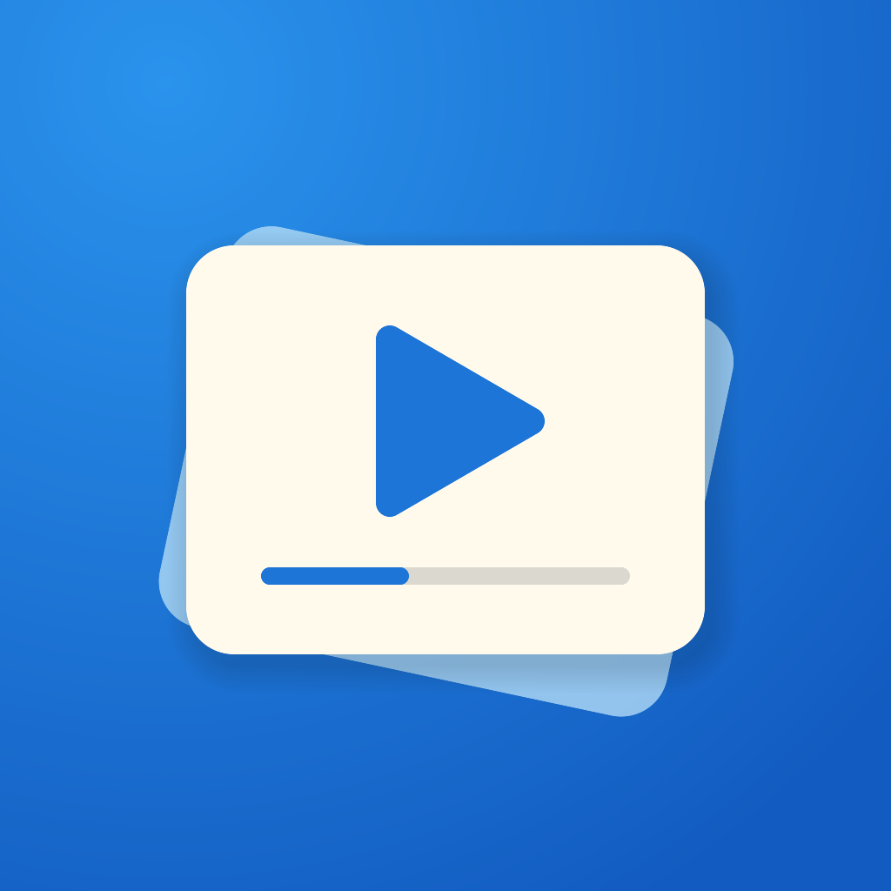

  

<h1 align="center">Vesper</h1>

  A native iOS content hub

  

## Screenshots

<picture>
  <source media="(max-width: 600px)" srcset="docs/screenshots/vesper-mobile.png">
  
</picture>

## What you can do

- Browse movies and shows with ratings, related titles, cast and crew. Actor pages show a biography, details and links.
- Add Stremio add-ons, or connect a Usenet provider to stream NZB releases found through NZBFinder or opened from Files. Search the source list for the one you want.
- Play in the built-in player with Picture in Picture, gesture controls, Skip Intro and Up Next. Add subtitles from SubDL. Open a source in VLC, Infuse or Outplayer instead if you prefer.
- Download titles to watch offline from add-on links or Usenet.
- Save titles to your library, back it up and continue watching later.
- Sync watched history with Trakt or SIMKL.
- Customize the Home screen and its catalogs.

## Get started

1. Download the [latest release](https://github.com/DjangoCustard225/Vesper/releases/latest) for **iOS 27 or later**. The unsigned IPA needs signing before installation.
2. Add your TMDB API key in **Settings → TMDB**. [Get an API key](https://www.themoviedb.org/settings/api).
3. Add a provider in **Settings → Add-ons** with its manifest URL or `stremio://` link, or add a Usenet provider in **Settings → Usenet**.
4. Open a title and tap **Play** to choose a source. Set your player in **Settings → Video Player**.

If you use Vesper in LiveContainer, enable **Settings → Video Player → Show all external players**.

Optional connections:

- **TVDB** gives shows better metadata, with TMDB as a fallback. Add your API key and subscriber PIN if required in **Settings → TVDB**. Some keys require a [TVDB subscription](https://thetvdb.com/subscribe).
- **MDBList** adds IMDb, Rotten Tomatoes and Letterboxd scores under a title's description. Add your key in **Settings → MDBList**.
- **SubDL** finds subtitles during playback. Add your key in **Settings → SubDL**.
- **NZBFinder** searches Usenet releases from movie and episode pages. Add your key in **Settings → Usenet → NZBFinder**.
- **Trakt** and **SIMKL** sync watched history. Connect them in **Settings → Tracking**. Built-in playback is reported to them. External playback isn't tracked.

Vesper doesn't supply content. You need your own add-ons or Usenet provider, and it doesn't support torrent downloads.

## Privacy

Your library and resume points stay on your device. Credentials, provider details and add-on settings are stored in iOS Keychain. Trakt, SIMKL and the other connections are optional, and only the ones you set up are contacted. Vesper has no ads or analytics.

## Credits

Vesper is independent of Stremio. Built-in playback uses [AetherEngine](https://github.com/superuser404notfound/AetherEngine). Usenet downloading and PAR2 repair are adapted from SwiftNZB under its [MIT license](Packages/UsenetEngine/LICENSE). RAR extraction uses Unrar.swift and UnRAR. Other third-party notices are in **Settings → About → Credits**.

Vesper is licensed under MIT. Third-party components keep their own licenses. See [LICENSE](LICENSE).
