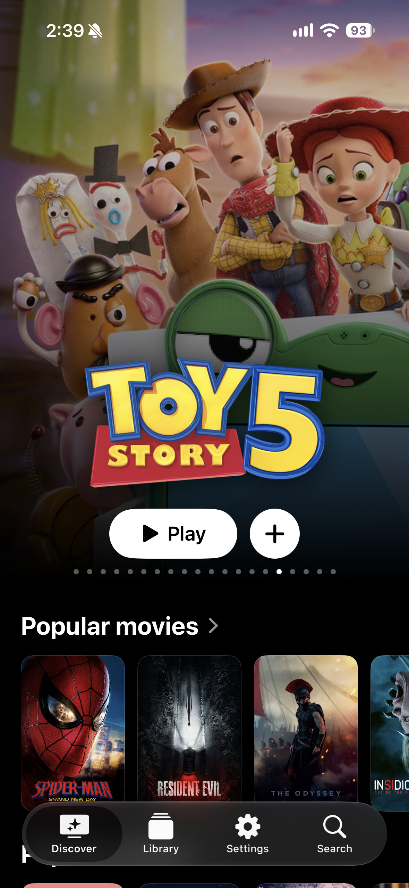
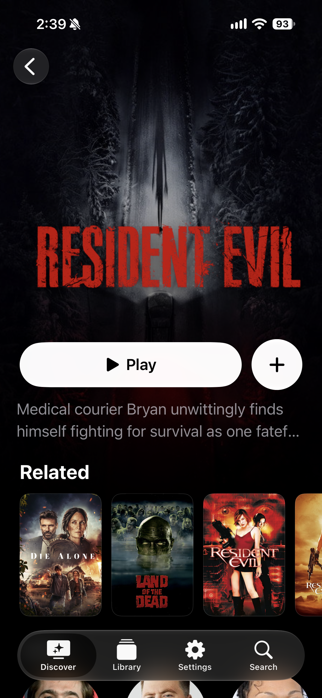
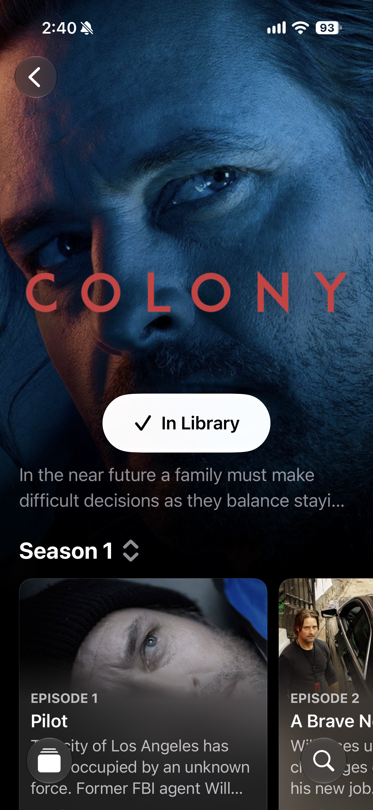
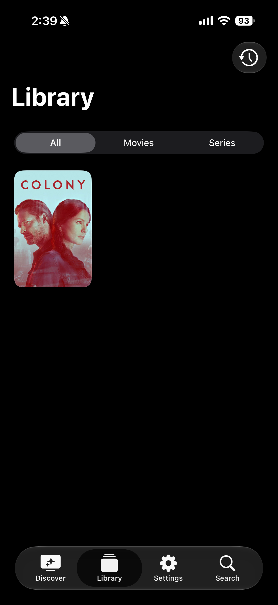

  

<h1 align="center">Vesper</h1>

  A native iOS content hub utilising Stremio add-ons.

  

  <a href="https://github.com/DjangoCustard225/Vesper/releases/latest/download/Vesper.ipa">Download IPA · Latest release</a>

Browse with TMDB, save titles to your library, and watch with external video players like Infuse or VLC.

## Screenshots

  
  &emsp;
  
  &emsp;
  
  &emsp;
  

## Features

- Browse movies and shows with immersive artwork and a customizable home carousel.
- Explore cast, crew, and related titles.
- Pick a season and browse episodes.
- Search titles and save favorites to your library.
- Watch with external video players like Infuse or VLC.

## Get started

1. Download the [latest release](https://github.com/DjangoCustard225/Vesper/releases/latest), sign the unsigned IPA, and install it on **iOS 27 or later**.
2. In **Settings → TMDB**, save and verify your [TMDB API key or Read Access Token](https://www.themoviedb.org/settings/api).
3. In **Settings → Add-ons → Add add-on**, install a provider using its manifest URL or `stremio://` link.
4. Install an external video player like **Infuse** or **VLC**, choose it in **Settings → Player**, then open a title and tap **Play**.

Use providers with playable HTTP/HTTPS sources. Vesper has no built-in player or on-device torrent engine.

## Privacy

Credentials and add-on configuration are stored in **iOS Keychain**; your library stays on your device. Requests go directly to TMDB and your providers. No analytics, ads, or tracking SDKs.

## Credits

Vesper is independent of Stremio. This product uses the TMDB API but is not endorsed or certified by TMDB.
