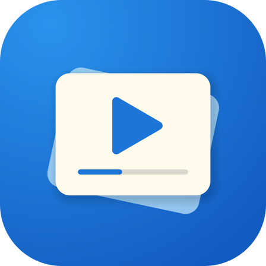
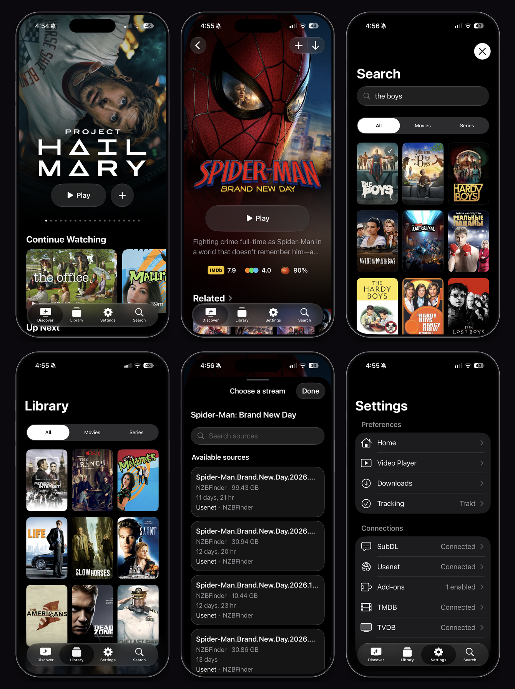

  

<h1 align="center">Vesper</h1>

  

Vesper is a media player written in Swift for iOS. It connects to external services and addons to display, stream and download content in a modern interface.

## Screenshots

<picture>
  <source media="(max-width: 600px)" srcset="docs/screenshots/vesper-mobile.png">
  
</picture>

## What you can do

- Browse movies and shows, cast and related titles.
- Stream from Stremio add-ons or your own Usenet provider.
- Use the built-in player, or use external players like VLC, Infuse or Outplayer.
- Download content to watch offline.
- Keep a library and sync watched history with Trakt or SIMKL.

## Get started

1. Download the IPA for **iOS 27 or later**. It's unsigned, so it needs signing before installation.
2. Add a TMDB API key in **Settings → TMDB**.
3. Optionally, configure the other services in the settings for an enriched experience.
4. Add an add-on in **Settings → Add-ons** or a Usenet provider in **Settings → Usenet**.
5. Open a title, tap **Play** and choose a source.

In LiveContainer, turn on **Settings → Video Player → Show all external players**. Vesper doesn't include content or support torrents.

## Privacy

Your library and resume points stay on your device. Credentials are stored in iOS Keychain. Vesper has no ads or analytics.

## Credits

Vesper is independent of Stremio. Playback uses [AetherEngine](https://github.com/superuser404notfound/AetherEngine) and Usenet downloading is adapted from SwiftNZB. Other notices are in **Settings → About → Credits**. Licensed under [MIT](LICENSE).
