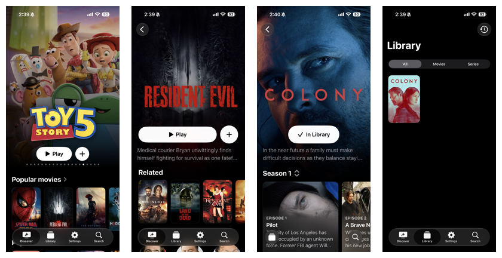

  

<h1 align="center">Vesper</h1>

  A native iOS content hub

  

  <a href="https://github.com/DjangoCustard225/Vesper/releases/latest/download/Vesper.ipa">Download Vesper</a>

Vesper brings movie and TV discovery, Stremio add-ons and playback together on iPhone and iPad. Find something to watch, save titles for later and pick up where you left off.

**Vesper** includes AVPlayer. You can also use Infuse, Outplayer or VLC.

For Dolby Vision and HDR playback, choose AVPlayer.

## Screenshots

<picture>
  <source media="(max-width: 600px)" srcset="docs/screenshots/readme-mobile.png">
  
</picture>

## What you can do

- Find movies and shows, explore cast and crew and browse related titles.
- Save titles, back up your library and continue watching later.
- Connect Trakt to sync watched history and built-in playback.

## Get started

1. Download the [latest release](https://github.com/DjangoCustard225/Vesper/releases/latest) for **iOS 27 or later**. The unsigned IPA needs signing before installation.
2. Add your TMDB API key in **Settings → TMDB**. [Get an API key](https://www.themoviedb.org/settings/api).
3. Add a provider in **Settings → Add-ons** with its manifest URL or `stremio://` link.
4. Open a title and tap **Play** to choose a source. Set your player in **Settings → Video Player**.

If you use Vesper in LiveContainer, enable **Settings → Video Player → Show all external players**.

For optional TV show metadata, add your TVDB API key and subscriber PIN if required in **Settings → TVDB**. TVDB becomes preferred for shows with TMDB as a fallback. Some keys require a [TVDB subscription](https://thetvdb.com/subscribe).

Connect Trakt in **Settings → Trakt** to import watch history and sync watched status. Playback in Vesper’s built-in player is reported to Trakt. External playback isn’t tracked.

Vesper needs providers with playable web streams. It doesn’t support torrent downloads.

## Privacy

Your library and resume points stay on your device. Credentials and add-on settings are stored in iOS Keychain. Trakt is optional. When connected, it syncs watch history and receives built-in playback activity. Vesper has no ads or analytics.

## Credits

Vesper is independent of Stremio. Built-in playback uses [AetherEngine](https://github.com/superuser404notfound/AetherEngine). Third-party notices are in **Settings → About → Credits**.

Vesper is licensed under MIT. Third-party components keep their own licenses. See [LICENSE](LICENSE).
